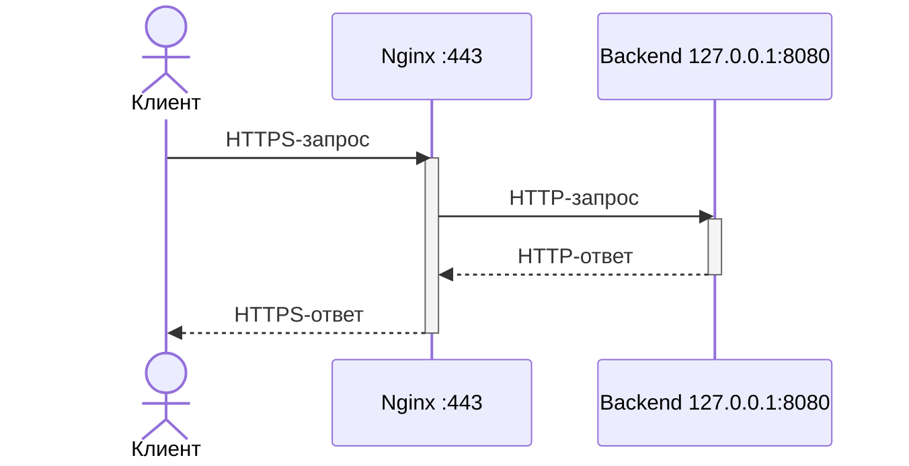

# Настройка HTTPS на Nginx с reverse proxy для backend-приложения

**Аудитория:** системный администратор Linux.

**Задача:** Настроить веб-сервер Nginx, который будет работать в роли обратного прокси (reverse proxy). То есть будет принимать HTTPS-запросы и передавать их backend-приложению на том же сервере.



## Prerequisites — предварительные требования

- Сервер с Ubuntu Server 24.04 LTS или Debian 12.
- Доступ к серверу с правами `sudo`.
- Доступ к репозиториям пакетов.
- Свободные TCP-порты `80` и `443`.
- Входящие TCP-подключения на порт `443` разрешены в firewall сервера и, при необходимости, в security group провайдера.
- Backend-приложение уже работает локально по HTTP на `127.0.0.1:8080`.
- Nginx и backend находятся в одном сетевом пространстве имён.
- Нужный доменный адрес приложения указывает на IP сервера через DNS.
- Корректное время на сервере и клиенте. (проверка командой `timedatectl status`)
- Каталог пакетов в системе обновлён. (команда `sudo apt update`)
- На сервере и клиентской Linux-машине установлен `curl`. Если его нет, установите командой `sudo apt install -y curl`.

> Далее в качестве примера адреса приложения будет использоваться `app.example.test`


## Шаг 1. Установить Nginx

Сначала нужно установить и запустить Nginx.

```bash
sudo apt install -y nginx
sudo systemctl enable --now nginx
sudo systemctl status nginx --no-pager
nginx -v
```

Что делают эти команды:

- `sudo apt install -y nginx` — устанавливает Nginx. Параметр `-y` автоматически подтверждает установку.
- `sudo systemctl enable --now nginx` — запускает Nginx и включает автоматический запуск после перезагрузки сервера.
- `sudo systemctl status nginx --no-pager` — показывает состояние службы прямо в терминале. Статус `active (running)` означает, что Nginx запущен; `--no-pager` отключает открытие вывода в отдельном просмотрщике.
- `nginx -v` — показывает версию установленного Nginx. Используется, чтобы убедиться, что nginx установлен.

Ожидаемый результат: сервис имеет статус `active (running)`, а `nginx -v` показывает версию Nginx.


*Скриншот 1 — заглушка. Заменить снимком терминала со статусом и версией Nginx.*

> Установка Nginx подробно описана в [официальной документации Ubuntu Server](https://ubuntu.com/server/docs/how-to/web-services/install-nginx/).

## Шаг 2. Создать самоподписанный (self-signed) сертификат через OpenSSL

Установите OpenSSL:

```bash
sudo apt install -y openssl
```

Проверьте, что OpenSSL успешно установился:

```bash
openssl version
```

Создайте каталог для сертификата и ключа:

```bash
sudo install -d -o root -g root -m 700 /etc/nginx/ssl
```

Здесь `install` создаёт каталог, а не устанавливает программу. `-d` обозначает создание каталога, `-o root` и `-g root` назначают владельца и группу, а `-m 700` разрешает доступ только владельцу — `root`.

Выпустите сертификат:

```bash
sudo openssl req -x509 -newkey rsa:2048 -sha256 -noenc -days 365 \
  -keyout /etc/nginx/ssl/app.example.test.key \
  -out /etc/nginx/ssl/app.example.test.crt \
  -subj "/CN=app.example.test" \
  -addext "subjectAltName=DNS:app.example.test" \
  -addext "basicConstraints=critical,CA:FALSE" \
  -addext "keyUsage=critical,digitalSignature,keyEncipherment" \
  -addext "extendedKeyUsage=serverAuth"
```

Параметры команды `openssl req`:

- `-x509` — создаёт самоподписанный сертификат.
- `-newkey rsa:2048` — создаёт новый RSA-ключ длиной 2048 бит.
- `-sha256` — выбирает SHA-256 для подписи сертификата.
- `-noenc` — сохраняет закрытый ключ без пароля, чтобы Nginx мог запускаться без ручного ввода.
- `-days 365` — задаёт срок действия сертификата: 365 дней.
- `-keyout /etc/nginx/ssl/app.example.test.key` — сохраняет закрытый ключ в указанный файл.
- `-out /etc/nginx/ssl/app.example.test.crt` — сохраняет сертификат в указанный файл.
- `-subj "/CN=app.example.test"` — записывает имя сайта в поле `CN` сертификата.
- `-addext "subjectAltName=DNS:app.example.test"` — добавляет имя сайта в SAN, по которому клиент проверяет сертификат.
- `-addext "basicConstraints=critical,CA:FALSE"` — указывает, что сертификат нельзя использовать как сертификат центра сертификации. `critical` требует учитывать это ограничение при проверке.
- `-addext "keyUsage=critical,digitalSignature,keyEncipherment"` — разрешает использовать ключ для цифровой подписи и шифрования ключа при установлении соединения. `critical` требует учитывать эти ограничения.
- `-addext "extendedKeyUsage=serverAuth"` — указывает, что сертификат предназначен для TLS-сервера.

> Подробнее о параметрах команды — в [справочнике OpenSSL req](https://docs.openssl.org/3.0/man1/openssl-req/), о расширениях сертификата — в [справочнике X.509v3](https://docs.openssl.org/3.0/man5/x509v3_config/).

В итоге создан каталог `/etc/nginx/ssl/`, в котором находятся два файла:

- `app.example.test.key` — закрытый ключ, который Nginx использует для HTTPS. Его нужно хранить в секрете.
- `app.example.test.crt` — самоподписанный сертификат, который Nginx предъявляет клиентам при HTTPS-подключении.

Позже мы добавим пути к этим файлам в конфигурацию Nginx.

Теперь стоит проверить, что сертификат содержит корректную информацию:

```bash
sudo openssl x509 -in /etc/nginx/ssl/app.example.test.crt \
  -noout -subject -issuer -dates -ext subjectAltName
```

Пример вывода для нашего сертификата:


*Скриншот 2 — заглушка. Показать сведения о сертификате: subject, issuer, срок действия и SAN.*

Как читать этот вывод:

- `subject=CN = app.example.test` — данные о том, для кого выпущен сертификат. **CN (Common Name)** — поле имени, которое мы задали параметром `-subj "/CN=app.example.test"`. Первый знак `=` отделяет название `subject` от его данных, второй знак `=` — поле `CN` от значения `app.example.test`.
- `issuer=CN = app.example.test` — данные того, кто подписал сертификат. Структура строки такая же, как у `subject`. В нашем примере эти данные совпадают, потому что сертификат самоподписанный.
- `notBefore` и `notAfter` — начало и конец срока действия. Даты приведены для примера: в вашем выводе они будут зависеть от момента создания сертификата; время указано в GMT (UTC).
- `X509v3 Subject Alternative Name:` — название расширения **SAN (Subject Alternative Name)**, содержащего список доменных имён или IP-адресов, для которых подходит сертификат. Его значение выводится на следующей строке: `DNS:app.example.test`. SAN здесь не пустое: `DNS:` обозначает доменное имя, а `app.example.test` — само имя.

Также нужно настроить доступы к файлам.

Эта команда назначает `root` владельцем обоих файлов и устанавливает для них группу `root`.

```bash
sudo chown root:root /etc/nginx/ssl/app.example.test.key /etc/nginx/ssl/app.example.test.crt
```

А эта команда разрешает чтение и изменение закрытого ключа только владельцем. Остальным пользователям доступ к файлу запрещён.

```bash
sudo chmod 600 /etc/nginx/ssl/app.example.test.key
```

## Шаг 3. Создать server block с SSL

Настройки сайтов для nginx хранятся в записях вида `server { ... }`, которые называются server blocks.

В Ubuntu/Debian настройки сайтов хранятся в двух каталогах:

- `/etc/nginx/sites-available/` — каталог **файлов** конфигурации сайтов.
- `/etc/nginx/sites-enabled/` — каталог **ссылок** на конфигурации, которые нужно подключить.

То есть нужно сначала создать нужный файл в `sites-available`, а затем добавить ссылку на него в `sites-enabled`.

Основной файл `/etc/nginx/nginx.conf` читает конфигурации из `sites-enabled` через директиву `include`.

Чтобы записать в файл `/etc/nginx/sites-available/backend-https` нужную конфигурацию HTTPS и проксирования, запустите команду:

```bash
sudo tee /etc/nginx/sites-available/backend-https > /dev/null <<'NGINX'
server {
    listen 443 ssl;
    server_name app.example.test;

    ssl_certificate     /etc/nginx/ssl/app.example.test.crt;
    ssl_certificate_key /etc/nginx/ssl/app.example.test.key;
    ssl_protocols TLSv1.2 TLSv1.3;

    access_log /var/log/nginx/backend-https.access.log;
    error_log  /var/log/nginx/backend-https.error.log;

    location / {
        proxy_pass http://127.0.0.1:8080;
        proxy_http_version 1.1;
        proxy_set_header Host $host;
        proxy_set_header X-Real-IP $remote_addr;
        proxy_set_header X-Forwarded-For $remote_addr;
        proxy_set_header X-Forwarded-Proto $scheme;
    }
}
NGINX
```

Здесь используется **heredoc** — способ передать команде многострочный текст прямо из терминала. Bash передаёт весь блок `server { ... }` команде `tee`, которая записывает его в файл конфигурации `/etc/nginx/sites-available/backend-https`.

Описание передаваемых параметров можно посмотреть в таблице параметров nginx.conf:

| Параметр | Значение в примере | Контекст | Назначение |
| --- | --- | --- | --- |
| `listen` | `443 ssl` | `server` | Принимает HTTPS на TCP 443 по IPv4. |
| `server_name` | `app.example.test` | `server` | Выбирает виртуальный сервер по имени. |
| `ssl_certificate` | `/etc/nginx/ssl/app.example.test.crt` | `server` | PEM-сертификат сервера. |
| `ssl_certificate_key` | `/etc/nginx/ssl/app.example.test.key` | `server` | Закрытый ключ сертификата. |
| `ssl_protocols` | `TLSv1.2 TLSv1.3` | `server` | Разрешённые версии TLS. |
| `access_log` | `/var/log/nginx/backend-https.access.log` | `server` | Журнал запросов. |
| `error_log` | `/var/log/nginx/backend-https.error.log` | `server` | Журнал ошибок сайта. |
| `location` | `/` | `server` | Обрабатывает все пути этого сайта. |
| `proxy_pass` | `http://127.0.0.1:8080` | `location` | Передаёт запросы по HTTP приложению на локальном IPv4-адресе и порту 8080. Исходный путь и параметры после `?` сохраняются. |
| `proxy_http_version` | `1.1` | `location` | Версия HTTP для соединения Nginx с backend. |
| `proxy_set_header Host` | `$host` | `location` | Передаёт backend имя сайта, к которому обратился клиент: `app.example.test`. |
| `proxy_set_header X-Real-IP` | `$remote_addr` | `location` | Передаёт IP-адрес клиента, подключившегося к Nginx. |
| `proxy_set_header X-Forwarded-For` | `$remote_addr` | `location` | Заменяет присланное клиентом значение на IP, который видит Nginx, чтобы клиент не подставил произвольный адрес в заголовке. |
| `proxy_set_header X-Forwarded-Proto` | `$scheme` | `location` | Сообщает backend исходную схему клиента — `https`, хотя от Nginx запрос приходит по HTTP. |

> **Важно:** настройте backend, чтобы он доверял этим заголовкам только от локального Nginx. Если перед Nginx появится другой прокси, потребуется пересмотреть список доверенных адресов и способ определения IP клиента.

> Подробнее о `proxy_pass` и передаче заголовков — в [документации ngx_http_proxy_module](https://nginx.org/en/docs/http/ngx_http_proxy_module.html).

> Контексты и директивы `listen`, `server_name`, `location` описаны в [ngx_http_core_module](https://nginx.org/en/docs/http/ngx_http_core_module.html).

У этой конфигурации есть две особенности:

- **Подключения по IPv4 и IPv6.** Это две версии IP-адресов: например, `192.0.2.10` — IPv4, а `2001:db8::10` — IPv6. Строка `listen 443 ssl;` принимает HTTPS-подключения по IPv4. Если сервер также настроен для IPv6 и клиенты должны подключаться по нему, добавьте в тот же блок `server` строку `listen [::]:443 ssl;`. Она включает приём HTTPS на порту `443` через IPv6; сама настройка IPv6 на сервере выполняется отдельно.
- **HTTP и HTTPS — отдельные подключения.** Адрес `http://app.example.test/` использует порт `80`, а `https://app.example.test/` — порт `443`. Наш server block настраивает только HTTPS. Стандартный HTTP-сайт, созданный при установке Nginx, продолжает работать отдельно. Автоматического перехода с HTTP на HTTPS здесь нет: для обращения к приложению открывайте адрес с `https://`.

> Подробнее о настройках сертификата и TLS — в [документации ngx_http_ssl_module](https://nginx.org/en/docs/http/ngx_http_ssl_module.html).

И теперь, чтобы Nginx прочитал созданный файл, добавьте символическую ссылку на него в каталог `sites-enabled`:

```bash
sudo ln -s /etc/nginx/sites-available/backend-https /etc/nginx/sites-enabled/backend-https
```

Символическая ссылка — отдельный файл, который указывает на другой файл или каталог. Можно сказать, что это ярлык. В команде выше первый адрес это исходный файл конфигурации, а второй адрес это место, где будет создана ссылка на этот файл.

## Шаг 4. Проверить работу сайта по HTTPS

### 4.1. Проверить синтаксис и перечитать конфигурацию

**Проверить конфигурацию и применить её**

```bash
sudo nginx -t && sudo systemctl reload nginx
```

- `nginx -t` — проверяет синтаксис конфигурации и возможность прочитать указанные файлы, включая сертификат и ключ. Если есть ошибка, показывает файл и строку.
- `&&` — запускает следующую команду только после успешной проверки.
- `systemctl reload nginx` — просит работающий Nginx перечитать настройки и применить созданную конфигурацию сайта.

Ожидаемый вывод `nginx -t`:

```text
nginx: the configuration file /etc/nginx/nginx.conf syntax is ok
nginx: configuration file /etc/nginx/nginx.conf test is successful
```

Подробнее о проверке конфигурации — в [справочнике параметров командной строки Nginx](https://nginx.org/en/docs/switches.html).

**Убедиться, что служба работает**

```bash
sudo systemctl is-active nginx
```

Ожидаемый ответ — `active`: служба Nginx запущена. Это ещё не подтверждает работу HTTPS или backend.

**Проверить, что Nginx принимает подключения на порту 443**

```bash
sudo ss -ltnp 'sport = :443'
```

Команда показывает процессы, которые слушают TCP-порт `443`:

- `-l` — только слушающие соединения.
- `-t` — TCP.
- `-n` — адреса и порты в числовом виде.
- `-p` — процесс, которому принадлежит сокет.
- `'sport = :443'` — оставляет в выводе только локальный порт `443`.

Ожидается строка `LISTEN` с портом `443` и процессом `nginx`. Это подтверждает, что Nginx готов принимать подключения. Сам HTTPS-запрос проверим дальше через curl.

### 4.2. Проверить локально, сохранив проверку сертификата

Самоподписанный сертификат не доверен браузеру по умолчанию, поэтому при открытии сайта появится предупреждение. Если обойти его, можно увидеть ответ приложения, но это не подтвердит корректную проверку сертификата. Поэтому для этой проверки используем `curl --cacert`: команда явно доверяет нашему сертификату и при этом проверяет его срок действия и соответствие имени сайта.

Сертификат создан для имени `app.example.test`, поэтому в запросе используем `https://app.example.test/`. Если указать IP-адрес вместо имени, curl сообщит об ошибке: сертификат не содержит этого IP-адреса. Адрес сервера curl получит через DNS, настроенный по предварительным требованиям.

На сервере выполните:

```bash
sudo curl --noproxy app.example.test \
  --cacert /etc/nginx/ssl/app.example.test.crt \
  --fail-with-body --show-error -i https://app.example.test/
```

Что означают параметры команды:

- `--noproxy app.example.test` — отправляет запрос напрямую, без использования прокси, который может быть настроен в окружении curl.
- `--cacert /etc/nginx/ssl/app.example.test.crt` — указывает сертификат, которому curl должен доверять при этой проверке. Системные настройки доверия не меняются.
- `--fail-with-body` — при HTTP-ошибке, например `404` или `502`, завершает команду с ненулевым кодом, но сохраняет вывод тела ответа.
- `--show-error` — включает вывод сообщений об ошибках, в том числе при использовании тихого режима curl.
- `-i` — показывает HTTP-заголовки ответа вместе с его содержимым, чтобы можно было увидеть статус запроса.
- `https://app.example.test/` — адрес проверяемого сайта; запрос отправляется к пути `/`.

Ожидаемый результат — `HTTP/1.1 200 OK` и тело ответа backend. Проверяйте рабочий endpoint вашего приложения и ожидаемое содержимое, а не только наличие HTTP-ответа.


*Скриншот 3 — заглушка. Показать успешный nginx -t и ответ curl с --cacert.*

Не используйте `curl -k` как итоговую проверку: он отключает проверку сертификата. Для проверки в браузере сначала настройте доверие к сертификату. Подробнее — [проверка сертификатов в curl](https://curl.se/docs/sslcerts.html).

### 4.3. Проверить с клиентской Linux-машины

Повторите запрос с другой Linux-машины, чтобы убедиться, что сайт доступен по сети.

На сервере подготовьте копию **публичного сертификата** для передачи клиенту:

```bash
sudo cat /etc/nginx/ssl/app.example.test.crt > "$HOME/app.example.test.crt"
```

Передавайте только `.crt`; закрытый ключ `.key` должен остаться на сервере.

На клиенте скачайте сертификат по SSH. Замените `admin` на свою SSH-учётную запись, `192.0.2.10` — на IP сервера:

```bash
scp admin@192.0.2.10:app.example.test.crt ./app.example.test.crt
```

Повторите проверку из пункта 4.2, указав скачанный файл в `--cacert`:

```bash
curl --noproxy app.example.test \
  --cacert ./app.example.test.crt \
  --fail-with-body --show-error -i https://app.example.test/
```

Ожидается тот же ответ backend. Проверка подтверждает доступность порта `443` с клиента и работу настроенного DNS.