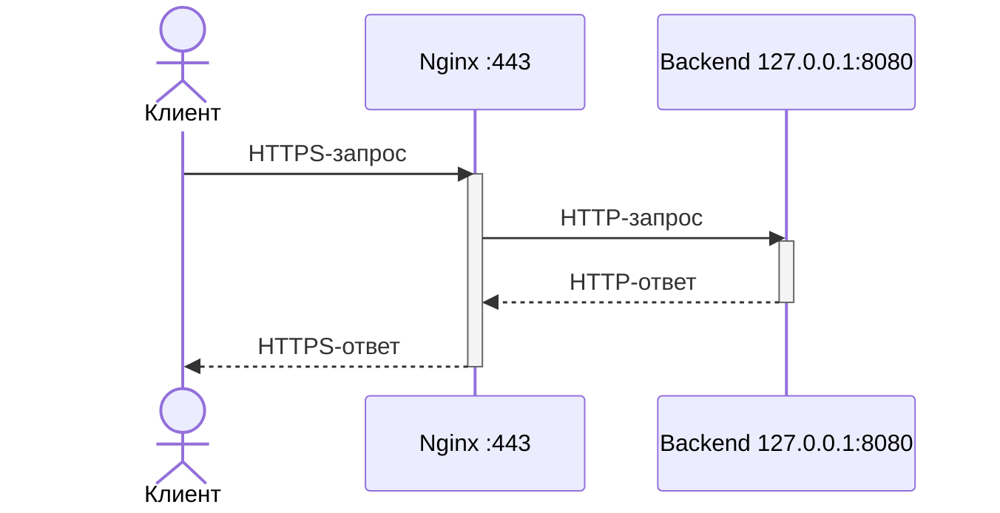

# Настройка HTTPS на Nginx с reverse proxy для backend-приложения

**Аудитория:** системный администратор Linux.

**Задача:** Настроить веб-сервер Nginx, который будет работать в роли обратного прокси (reverse proxy). То есть будет принимать HTTPS-запросы и передавать их backend-приложению на том же сервере.



## Prerequisites — предварительные требования

- Сервер с Ubuntu Server 24.04 LTS или Debian 12.
- Доступ к серверу с правами `sudo`.
- Доступ к репозиториям пакетов.
- Свободные TCP-порты `80` и `443`.
- Входящие TCP-подключения на порт `443` разрешены в firewall сервера и, при необходимости, в security group провайдера.
- Backend-приложение уже работает локально по HTTP на `127.0.0.1:8080`.
- Nginx и backend находятся в одном сетевом пространстве имён.
- Нужный доменный адрес приложения указывает на IP сервера через DNS.
- Корректное время на сервере и клиенте. (проверка командой `timedatectl status`)
- Каталог пакетов в системе обновлён. (команда `sudo apt update`)
- На сервере и клиентской Linux-машине установлен `curl`. Если его нет, установите командой `sudo apt install -y curl`.

> Далее в качестве примера адреса приложения будет использоваться `app.example.test`


## Шаг 1. Установить Nginx

Сначала нужно установить и запустить Nginx.

```bash
sudo apt install -y nginx
sudo systemctl enable --now nginx
sudo systemctl status nginx --no-pager
nginx -v
```

Что делают эти команды:

- `sudo apt install -y nginx` — устанавливает Nginx. Параметр `-y` автоматически подтверждает установку.
- `sudo systemctl enable --now nginx` — запускает Nginx и включает автоматический запуск после перезагрузки сервера.
- `sudo systemctl status nginx --no-pager` — показывает состояние службы прямо в терминале. Статус `active (running)` означает, что Nginx запущен; `--no-pager` отключает открытие вывода в отдельном просмотрщике.
- `nginx -v` — показывает версию установленного Nginx. Используется, чтобы убедиться, что nginx установлен.

Ожидаемый результат: сервис имеет статус `active (running)`, а `nginx -v` показывает версию Nginx.


*Скриншот 1 — заглушка. Заменить снимком терминала со статусом и версией Nginx.*

> Установка Nginx подробно описана в [официальной документации Ubuntu Server](https://ubuntu.com/server/docs/how-to/web-services/install-nginx/).